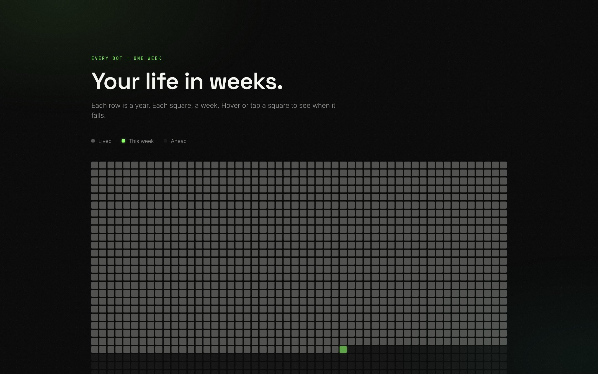
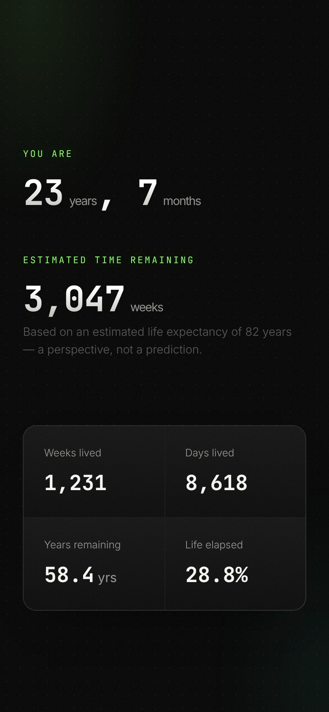

# UNTIL.

**You don't have forever.**

**Live:** [abejit-singh.github.io/until](https://abejit-singh.github.io/until/)

UNTIL is a single-page, interactive visualization of your life: how much of it you've lived, how much you may have left, and what your daily habits are quietly costing you in years.

No backend, no framework, no build step. Everything runs in the browser and is saved in its `localStorage`.

<p>
  
  
</p>

## Features

- **Your life.** Age in years and months, weeks lived and remaining, days lived, years remaining and the share of your chosen lifespan already lived.
- **Your life in weeks.** A generated grid with one square per week and one row per year of age. The current week is highlighted, and hovering or tapping any square shows the date it represents.
- **Habit calculator.** Turn daily hours (sleep, work, social media, etc.) into years of your life, shown as bars.
- **What If.** Drag a slider to see how many years and hours you'd get back by changing a habit. It never suggests sleeping less than 7 hours.
- **Milestones.** Future goals with dates, shown in order on a timeline.
- **Make Today Count.** A closing, reflective screen with a random prompt.

All numbers are computed live from the date of birth and life expectancy you enter. Nothing is hardcoded or simulated.

## How the numbers are calculated

| Figure                  | Formula                                                                                                                          |
| ----------------------- | -------------------------------------------------------------------------------------------------------------------------------- |
| Age                     | calendar years and months since your date of birth                                                                               |
| Weeks lived / remaining | whole 7-day weeks from your birth to today, and from today to the day you turn your chosen life expectancy                       |
| Life elapsed            | days lived ÷ days from birth to that day                                                                                         |
| Grid                    | 52 squares per row, one row per year of age. This week's square sits at row = your age, column = weeks since your last birthday. |
| Habit in years          | hours per day ÷ 24 × life expectancy                                                                                             |
| What If                 | hours saved per day ÷ 24 × years remaining                                                                                       |

## Running it locally

You need [Node.js](https://nodejs.org) 22 or later.

```sh
npm install
npm start
```

Then open <http://127.0.0.1:5173>.

The page is made of ES modules, which browsers only load from a server: opening `index.html` with a double-click shows an empty page. `npm start` runs a small static server; any other one works too.

## Scripts

| Command             | What it does                                              |
| ------------------- | --------------------------------------------------------- |
| `npm start`         | Serves the site at `http://127.0.0.1:5173`                |
| `npm run lint`      | ESLint, Stylelint and a Prettier formatting check         |
| `npm run format`    | Formats every file with Prettier                          |
| `npm run test:unit` | Unit tests of the calculations and the saved data         |
| `npm run test:e2e`  | The page in a real browser, at a desktop and a phone size |
| `npm test`          | Both kinds of test                                        |

The browser tests use [Playwright](https://playwright.dev), which needs its browser once: `npx playwright install chromium`.

## Project structure

```
index.html            the page: the markup of every section
css/
  fonts.css           the typefaces the site serves itself
  style.css           every style, by section, with a contents list at the top
js/
  main.js             entry point: starts the app
  config.js           constants, limits and the state a first visit starts from
  utils.js            small helpers: numbers, dates, escaping
  life.js             the maths: age, weeks lived, weeks left
  state.js            the saved data: loading, checking, saving
  effects.js          motion: counting numbers, sliders, pointer effects
  weeks.js            the headline figures and the grid of weeks
  habits.js           the list of habits and its chart
  what-if.js          the What If slider
  milestones.js       the timeline of milestones
  flow.js             from the setup form to the results
  events.js           every event listener
fonts/                the typefaces (woff2) and their licences
icons/                the app icons
images/               the preview shown when the link is shared
docs/                 the screenshots on this page
tests/
  unit/               the calculations and the saved data, run in Node
  e2e/                the page in a real browser (Playwright)
manifest.json         app name, colours and icons for installation
service-worker.js     offline support
```

## How it is built

- **No framework and no build step.** Plain HTML, CSS and JavaScript. The files in this repository are the files the browser runs, and GitHub Pages serves the `main` branch as it is.
- **ES modules.** One module for each part of the page, loaded by the browser from `js/main.js`. The foundation (`config.js` → `utils.js` → `state.js`) imports nothing from the modules built on top of it.
- **One state object.** Everything the user enters lives in one object, saved to `localStorage` after every change. When it is read back every field is checked, so damaged or hand-edited data cannot break the page.
- **Rendering.** Each section has a function that rebuilds its markup from the state. Text typed by the user is escaped before it is inserted.
- **The maths is separate from the page.** Every figure comes from pure functions in `js/life.js` that take a date of birth, a life expectancy and "today". The unit tests call them with fixed dates, and the browser tests freeze the clock, so the expected numbers never change.
- **Nothing comes from another site.** The typefaces (Inter, Space Grotesk and JetBrains Mono) are served from this repository, and a Content Security Policy (`default-src 'self'`) makes the browser refuse anything else.
- **Offline.** A service worker keeps a copy of the app. Online, the page is always fetched fresh, so an update shows immediately; the copy is only used when there is no connection.
- **Motion is optional.** Animations are switched off for people who ask their system for reduced motion.

## Quality

- **Tests.** Unit tests for the calculations and for the data read back from storage; browser tests that use the page the way a visitor does, including reopening it with no connection and checking that it calls no other site.
- **Accessibility.** Labelled controls, keyboard access and text contrast that meets WCAG AA, checked with axe on the empty page and with data.
- **Lighthouse** (phone profile, on a local copy served the way GitHub Pages serves it, November 2026): Performance 99 · Accessibility 100 · Best Practices 100 · SEO 100.

## Installing as an app (PWA)

UNTIL is a Progressive Web App: on the live site you can install it like a native app, with a "U." monogram matching the site's wordmark, and it keeps working offline.

- **On mobile:** open the site, then use your browser's "Add to Home Screen" option (Safari: Share → Add to Home Screen; Chrome: menu → Install app).
- **On desktop:** Chrome and Edge show an install icon in the address bar.

## Privacy

UNTIL collects nothing and sends nothing anywhere. There is no backend at all.

- **What's stored:** your date of birth, life expectancy, habits and milestones. They are saved only in your browser's `localStorage`, under the key `until_state_v1`.
- **Where it goes:** nowhere. It never leaves your device. There's no analytics, tracking, cookies or logging of any kind.
- **Outside requests:** none. The page and its fonts come from this site, and the Content Security Policy blocks any other connection.
- **Security:** all text you enter is escaped before it is displayed, and saved data is validated every time it is read.
- **Clearing your data:** use the reset button (bottom-left of the site) at any time.

## Third-party files

Fonts: see [`fonts/README.md`](fonts/README.md) (SIL Open Font License).

## Disclaimer

UNTIL is a visualization based on a life expectancy **you** choose. It is not a medical, actuarial or scientific prediction of anything. It's intended for a general audience: there's nothing in it unsuitable for younger users, though the reflective, mortality-adjacent framing is aimed at teens and adults.

## Copyright

© 2026 Abejit. All rights reserved.

This project is shared publicly on GitHub for portfolio purposes. No license is granted to copy, modify, redistribute or reuse this code or design. Please don't recreate this project. If you'd like to use any part of it, get in touch first.
